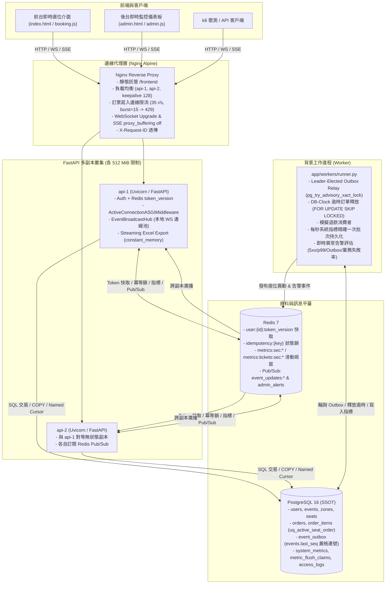

# Flash-Ticket 系統架構與設計問答 (DESIGN.md)

本文件對應評測規範第二節（系統架構圖）、第八節（Q1–Q6 設計問答）以及階段九（512 MiB 串流報表匯出），所有設計結論皆附帶對應程式碼檔案行號、GitHub Commit 永久連結與實測驗證數據。

---

## 零、系統架構圖與資料流向



### 核心資料流向說明
1. **寫入與狀態唯一真實來源（SSOT）**：所有搶票、付款、取消、逾時釋放與退款狀態轉換，一律在 PostgreSQL 單一 ACID 交易內完成，並同步寫入 `event_outbox`（連帶遞增 `events.last_seq`）。
2. **即時推播流程**：背景 `Worker` 透過 `pg_try_advisory_xact_lock` 選出唯一 Leader，依 `(event_id, sequence_id ASC)` 順序發布至 Redis Pub/Sub；`api-1` 與 `api-2` 各自的 `EventBroadcastHub` 訂閱後推送至前端 WebSocket。
3. **觀測與告警流程**：API 副本於 ASGI 層記錄請求耗時、狀態碼與活躍連線至 Redis 緩衝；`Worker` 每秒以 `metric_flush_claims` 冪等鎖批次持久化至 PostgreSQL，並同步評估 4 條告警規則，透過 Redis Pub/Sub 與 SSE 推送至 Admin 後台。

## 設計假設與方案取捨摘要

| 問題 | 設計假設與選擇 | 替代方案及取捨 | 驗證方式 |
| :--- | :--- | :--- | :--- |
| Q1 座位不超賣 | PostgreSQL 是座位和訂單狀態的準據；用條件更新、交易鎖和部分唯一索引保護寫入。 | Redis 鎖或應用程式先讀再寫，仍需處理鎖過期、跨副本競爭及 DB 寫入競態。活動序號使用交易內的 `events.last_seq`，而非 PostgreSQL `SEQUENCE`；這樣回滾時序號也回滾、不留空號，代價是同一活動的成功寫入會爭用該列。 | 併發搶位、反向鎖序測試及破壞性測試；見 `tests/test_concurrency.py` 與 `docs/evidence/q1_deliberate_failure.log`。 |
| Q2 部分失敗 | PostgreSQL 時鐘與交易作為狀態依據；DB commit 和 Redis 發布分開時，用 Outbox、冪等資料庫查詢及 Worker 重試收斂。 | 直接在 API commit 後發布，程序若在兩步之間中止會漏通知；使用應用程式時鐘則會受副本時鐘偏差影響。 | `kill -9` 復原、時鐘偏差、雙 Worker 逾時清理測試；另列出尚未可靠恢復的存取日誌窗口（Q2.1）。 |
| Q3 重試與限購 | 客戶端可能重送，同一使用者也可能用不同 key 同時購票；Redis 記錄處理中狀態，DB 唯一鍵兜底，限購在 DB 交易鎖內檢查。 | 單靠程序內鎖無法協調多個 API 副本；單靠 Redis 冪等狀態也不能取代 DB 的持久唯一約束。代價是 Redis 與 DB 都需參與請求流程。 | 相同 key 重送、參數不符、DB 回源及雙 key 併發測試；見 `tests/test_tickets.py` 和 `tests/test_concurrency.py`。 |
| Q4 即時推送 | 畫面只需即時呈現座位狀態；離線期間可用事件序號偵測漏訊，再補事件或重取快照。 | Redis Pub/Sub 不保存離線訊息；Streams/Kafka 可保留訊息，但增加消費者 offset 與維運成本。此設計接受 Pub/Sub 漏送窗口，以序號與快照補同步。Outbox 目前未設定清理週期，長期運作會持續增加資料庫儲存量。 | Outbox 順序、跨副本廣播、斷線補發、慢客戶端與 2,000 WebSocket 壓測；見 `tests/test_realtime.py`、`LOADTEST.md`。 |
| Q5 權限與憑證 | DB 的 `token_version` 是憑證版本依據；Redis 用於快速拒絕舊 Token，讀取使用者時仍核對 DB。 | JWT blacklist 需按 token 維護撤銷記錄；完全無狀態 JWT 無法即時撤銷。DB 核對有效 Token 的成本較高，基準測試 p50 為 41.269 ms。 | 登出、停用、改角色、快取故障及授權矩陣測試；效能數據見 `docs/evidence/q5_token_benchmark.txt`。 |
| Q6 監控 | 監控資料可延遲批次寫入，但需要避免重複累加；Redis 暫存 24 小時，Worker 以 DB claim 去重後寫入。 | 每個請求直接寫 DB 會增加主交易資料庫負載；目前 Redis 暫存是有期限的，Worker/DB 中斷超過 24 小時或 Redis 資料遺失時，未落庫指標可能遺失。存取日誌也有獨立的取出與寫入窗口。 | 多副本時鐘偏差、inflight 復原、TTL、claim 清理及告警測試；見 `tests/test_monitoring.py`。 |

---

## Q1　座位不超賣

### 1.1 指定座位購買之完整路徑與鎖定邊界

對應實作：[`app/tickets/service.py`](https://github.com/CYLiao1127/flash-ticket/blob/52be8a21183da184dd5b74214ce597d8e80f6593/app/tickets/service.py)（Commit `d66ca92`、`52be8a2`）與 [`app/models.py`](https://github.com/CYLiao1127/flash-ticket/blob/5d597cfd328ce936f396405ddcd2e00dce745962/app/models.py#L481)（Commit `5d597cf`）。

1. **冪等鍵檢查（交易外快速路徑）**：`app/tickets/service.py:296-332` 先檢查 Redis `idempotency:{key}`；若已存在直接回 `200`（完成）、`409`（處理中）或 `422`（參數指紋不符）。
2. **取得第一層保護 — 使用者單場限購原子鎖**：
   - **開始取得保護**：`app/tickets/service.py:67` 執行 `SELECT pg_advisory_xact_lock(hashtext(:lock_key))`（`lock_key = f"{user_id}_{event_id}"`）。
   - **保證內容**：將同一位使用者對同一活動的所有併發搶票（含雙 Key 同時請求）序列化，避免統計有效票數（`held` + `paid`）與建立新訂單之間出現 TOCTOU 競態，確保單人每場不超過 4 張。
3. **取得第二層保護 — 條件原子更新 + 固定鎖序防死結**：
   - **開始取得保護**：`app/tickets/service.py:354-365` 先將 `seat_ids` 依 `sorted(set(seat_ids))`（`seat_id ASC`）排序，再逐筆執行條件原子更新：
     ```sql
     UPDATE seats
     SET status = 'held', version = version + 1, updated_at = NOW()
     WHERE id = :seat_id AND event_id = :event_id AND status = 'available'
     RETURNING id, zone_code, row_label, seat_number
     ```
   - **保證內容**：PostgreSQL 更新時會取得資料表層級的 `ROW EXCLUSIVE` 鎖，並鎖定符合條件的座位列；第二位併發買家會在等待第一筆交易提交後重讀新版本（`status = 'held'`），`WHERE` 條件不成立而回傳 0 列，立即觸發 `409 Conflict` 與整體交易回滾。固定 `seat_id ASC` 順序則保證多個多張選位交易之間不會產生交叉死結。
4. **取得第三層保護 — 資料庫部分唯一索引**：
   - `app/models.py:481`（`uq_active_seat_order`）：對 `order_items(seat_id)` 建立 `UNIQUE INDEX ... WHERE status IN ('held', 'paid')`。即使應用層未來出現程式碼退化，資料庫層仍強制拒絕同一座位存在兩筆有效訂單項目。
5. **原子遞增活動序號與寫入 Outbox**：
   - `app/tickets/service.py:185-187` 最後才更新 `events.last_seq = last_seq + 1 RETURNING last_seq`（嚴格鎖順序：`advisory_lock → seats → events.last_seq`，將熱點 `events` 列鎖持有時間壓縮到提交前最後一刻）。
6. **釋放所有保護**：
   - `app/tickets/service.py:445` 執行 `await db.commit()`（或異常時 `rollback()`），PostgreSQL 自動同時釋放交易級 `pg_advisory_xact_lock`、所有 `seats` 行鎖與 `events` 行鎖。

### 1.2 逾時釋放與遲到付款同時發生時的處理

**情境：逾時釋放 Worker 與付款成功 Webhook 同時處理訂單，且另一位使用者已買走原座位。**
- **時間線**：
  1. `T0`：User A 鎖定 Seat #1（Order #100 `pending`，`expires_at = T0 + 10m`）。
  2. `T0 + 10m + 1s`：逾時 Worker 掃描到 Order #100，將 Order #100 改為 `cancelled`、Seat #1 釋放回 `available`。
  3. `T0 + 10m + 2s`：User B 立刻下單鎖定並付款成功，Seat #1 變為 `sold`（Order #101 `paid`）。
  4. `T0 + 10m + 3s`：金流延遲回呼抵達，通知 Order #100 `succeeded`。若 Webhook 處理程式直接把 Order #100 改為 `paid`、Seat #1 改為 `sold`，同一座位將同時賣給 User A 與 User B。
- **本系統為何擋得住**（Commit `54899c8`，[`app/payments/service.py:465`](https://github.com/CYLiao1127/flash-ticket/blob/54899c843a89bac9d4a61431b7b1fdcacc748b5e/app/payments/service.py#L465)）：
  - 遲到 Webhook 進入交易後，以 `ORDER BY id ASC FOR UPDATE` 鎖定原訂單所有座位並檢查是否**全部仍為 `available`**。
  - 若有任何一席已被 User B 佔用（`held`/`sold`），系統拒絕復活訂單，保留原訂單為 `cancelled` 並寫入 `refund_requested` 退款紀錄與 Outbox 事件，由背景退款消費者自動退款給 User A。
  - 即使程式漏查，`uq_active_seat_order` 仍會以 `IntegrityError` 攔截雙重 `paid` 寫入。

### 1.3 併發測試與破壞性超賣復現存證

- **測試案例**：`tests/test_concurrency.py::test_high_concurrency_anti_overselling_reserve_and_allocate_consistency`（Commit `37b4b9b`）。
- **刻意破壞與還原 Commit**：
  - 破壞存證 Commit [`4c7af9b`](https://github.com/CYLiao1127/flash-ticket/commit/4c7af9b740018096fc693efd93307228d147f9d7)
  - 還原保護 Commit [`906a3b7`](https://github.com/CYLiao1127/flash-ticket/commit/906a3b7b3cecc7d76576c335e331b82b836311d4)
  - 完整實驗紀錄：[docs/evidence/q1_deliberate_failure.log](docs/evidence/q1_deliberate_failure.log)
- **實驗結果摘要（30 名買家併發搶 1 個 VIP 座位）**：
  - **實驗 A（僅拔除 `uq_active_seat_order`，保留條件原子更新）**：`1 passed`（僅 1 人成功、29 人 409，驗證第一層條件更新可獨立防止超賣）。
  - **實驗 B（同時拔除部分唯一索引，並將條件更新改成無鎖先讀後寫）**：測試立即抓出 **30 倍超賣**：
    ```text
    tests/test_concurrency.py:146: in test_high_concurrency_anti_overselling_reserve_and_allocate_consistency
        assert len(winners_1) == 1
    E   AssertionError: assert 30 == 1
    FAILED tests/test_concurrency.py::test_high_concurrency_anti_overselling_reserve_and_allocate_consistency
    ```

---

## Q2　部分失敗後的狀態收斂

### 2.1 系統中的部分失敗時間窗（列出 5 個）

| # | 時間窗 | 已完成部分 | 尚未完成部分 |
| :-: | :--- | :--- | :--- |
| 1 | **訂單提交 vs. 即時推播** | PostgreSQL 已 commit 座位 `held`/`sold`/`available` 與 `event_outbox(status='pending')` | Worker 尚未將事件發布至 Redis Pub/Sub，前端座位圖仍顯示舊狀態 |
| 2 | **訂單提交 vs. Redis 冪等快取回填** | PostgreSQL 已 commit 訂單與 `orders.idempotency_key` | API 在 `complete_idempotency_slot` 寫回 Redis 前遭遇 `kill -9`，Redis 仍殘留 `PROCESSING` 鎖 |
| 3 | **指標批次寫入 DB vs. 清除 Redis 緩衝** | `Worker` 已將該秒指標 commit 至 `system_metrics` 與 `metric_flush_claims` | `Worker` 在刪除 Redis bucket 前崩潰，下次啟動會重讀同批 Redis 資料 |
| 4 | **遲到付款退款記錄 vs. 模擬退款處理** | PostgreSQL 已記錄 `refund_requested` 與 Outbox 事件 | Worker 尚未處理退款事件並更新模擬退款狀態 |
| 5 | **存取日誌從 Redis 佇列寫入 DB** | Worker 先讀取佇列項目 | `flush_access_logs_batch` 在 DB commit 前執行 `LTRIM`；若程序於 trim 後、commit 前被終止，該批日誌可能遺失 |

### 2.2 API 在寫回冪等快取前中止時的恢復方式

- **情境（時間窗 #2）**：API 提交訂單後、回填 Redis 冪等結果前被 `kill -9`，客戶端未收到回應而以相同 `Idempotency-Key` 重送。
- **收斂流程**（[`app/tickets/service.py:218-262`](https://github.com/CYLiao1127/flash-ticket/blob/52be8a21183da184dd5b74214ce597d8e80f6593/app/tickets/service.py#L218-L262) 與 `tests/test_recovery.py::test_kill_9_mid_transaction_recovery_and_state_convergence_q22`）：
  1. 在 Redis `PROCESSING` 鎖 TTL（預設 `30s`）過期前，重送請求收到 `409 Conflict`（告知前次請求處理中，請稍後重試）。
  2. TTL 過期（或 Redis 重啟清空）後，重送請求會回源查詢資料庫 `SELECT * FROM orders WHERE idempotency_key = :key`，命中已提交的訂單並核對請求指紋後，回填 Redis 快取並直接回傳原本的 `200 OK` 訂單結果，不會重複扣位。
  3. 同步地，未送出的 Outbox 事件會在 `Worker` 下一個輪詢週期（`<= 1s`）被 Relay 補發至 Redis Pub/Sub。
- **恢復時間**：Outbox 最長約 1 秒後重送；Redis 冪等鎖最長 30 秒後過期，重試請求再從資料庫取回原訂單。這兩種情況都不需要人工清理。

### 2.3 逾時判斷之時鐘來源與無 `sleep` 測試策略

- **採用時鐘**：一律以 **PostgreSQL 資料庫伺服器時鐘 `NOW()`** 作為唯一判斷基準（[`app/payments/service.py:675`](https://github.com/CYLiao1127/flash-ticket/blob/54899c843a89bac9d4a61431b7b1fdcacc748b5e/app/payments/service.py#L675)，`Order.expires_at <= func.now()`）。
- **原因**：多台 API 與 Worker 容器之間可能存在 NTP 漂移；若改用 Python 應用層 `datetime.now()`，快時鐘節點可能提前取消尚未過期的訂單，慢時鐘節點則會延遲釋放座位。
- **無 `sleep` 測試覆蓋**（Commit `94557ac`，[`tests/test_recovery.py`](https://github.com/CYLiao1127/flash-ticket/blob/94557aca7353fa52fe46239f3e03a44f8124256b/tests/test_recovery.py)）：
  - `test_clock_skew_injection_relies_solely_on_db_clock_q23` 直接以 SQL 將測試訂單的 `expires_at` 設為 `NOW() - interval '1 second'` 與 `NOW() + interval '5 minutes'`，同時 monkeypatch 應用層時鐘快轉 +2 小時，驗證 Worker 僅釋放 DB 時鐘已過期的訂單、結果只取決於資料庫時鐘；測試不使用 `time.sleep`。

### 2.4 雙 Worker 同時執行逾時清理的正確性

- **結果**：兩個 Worker 以 `SKIP LOCKED` 分別處理可用訂單，不會同時鎖住同一筆。測試會核對釋放訂單數與 Outbox 事件數，確認沒有重複。
- **關鍵行**：[`app/payments/service.py:668-680`](https://github.com/CYLiao1127/flash-ticket/blob/54899c843a89bac9d4a61431b7b1fdcacc748b5e/app/payments/service.py#L668-L680)：
  ```python
  select(Order)
  .where(Order.status == OrderStatus.PENDING.value, Order.expires_at <= func.now())
  .order_by(Order.expires_at.asc(), Order.id.asc())
  .limit(batch_size)
  .with_for_update(skip_locked=True)
  ```
- **驗證**：`tests/test_recovery.py::test_dual_workers_concurrent_expiry_cleanup_idempotency_q24` 併發啟動兩個 Worker 搶同一批過期訂單，斷言總釋放訂單數與 Outbox 事件數嚴格等於過期筆數（零重複）。

---

## Q3　重試、冪等與限購

### 3.1 `Idempotency-Key` 三種重送情境

實作位於 [`app/tickets/idempotency.py`](https://github.com/CYLiao1127/flash-ticket/blob/52be8a21183da184dd5b74214ce597d8e80f6593/app/tickets/idempotency.py) 與 [`app/tickets/service.py:218-262, 310-332`](https://github.com/CYLiao1127/flash-ticket/blob/52be8a21183da184dd5b74214ce597d8e80f6593/app/tickets/service.py#L218-L262)：

| 情境 | HTTP 狀態碼 | 回傳行為與原因 |
| :--- | :---: | :--- |
| **第一次請求已經成功** | `200 OK` | 核對請求指紋（SHA-256 of `user_id + action + event_id + params`）一致後，直接回傳原訂單 JSON（Redis 命中或回源查 DB `orders.idempotency_key`），不重新鎖位。 |
| **第一次請求仍在處理中** | `409 Conflict` | Redis `SET NX` 鎖仍處於 `PROCESSING` 狀態，拒絕並行重複執行，提示客戶端稍後重試。 |
| **相同 Key 但請求內容不同** | `422 Unprocessable Entity` | 請求指紋比對失敗（無論在 Redis 階段或 DB 回源階段），立即拒絕以防誤用舊 Key 覆寫不同購票意圖。 |

### 3.2 雙 Key 併發「區域配位」與單人 4 張限購原子性

- **是否在同一個原子操作內**：**是**，透過資料庫交易內的 `pg_advisory_xact_lock` 強制序列化。
- **確切位置**：[`app/tickets/service.py:67`](https://github.com/CYLiao1127/flash-ticket/blob/52be8a21183da184dd5b74214ce597d8e80f6593/app/tickets/service.py#L67)（於 `reserve_specific_seats` 與 `allocate_zone_seats` 交易開頭呼叫 `_acquire_user_event_limit_lock`），緊接著在同一交易內查詢該使用者有效票數並插入新訂單。
- **若不加此鎖會發生什麼事**：兩筆各買 3 張（合計 6 張 > 4）且使用不同 `Idempotency-Key` 的請求在 `READ COMMITTED` 下會同時讀到「目前 0 張」，雙雙通過限購檢查並各自成功配位，導致單人買到 6 張違反限購規定。
- **驗證測試**：`tests/test_concurrency.py::test_dual_idempotency_key_concurrent_allocation_enforces_4_ticket_limit`。

### 3.3 資料庫內配位 vs. 應用程式記憶體挑選

- **實作選擇**：**資料庫內挑選**（[`app/tickets/service.py:549-560`](https://github.com/CYLiao1127/flash-ticket/blob/52be8a21183da184dd5b74214ce597d8e80f6593/app/tickets/service.py#L549-L560)）：
  ```sql
  SELECT id, zone_code, row_label, seat_number
  FROM seats
  WHERE event_id = :event_id AND zone_code = :zone_code AND status = 'available'
  ORDER BY id ASC
  LIMIT :quantity
  FOR UPDATE SKIP LOCKED
  ```
  並搭配複合部分索引 `ix_seats_allocation`（`app/models.py:338`）。
- **為何不在應用記憶體挑選**：若先 `SELECT` 可用座位至 Python 再挑前 N 個去 `UPDATE`，在高併發搶購同一區域時，數百個請求會同時挑中**相同的頭幾個座位**，可能增加鎖競爭，並讓請求因同時挑到相同座位而收到 `409 Conflict`，即使該區仍有其他空位。`FOR UPDATE SKIP LOCKED` 讓每個併發交易自動跳過已被鎖定的列，直接拿到下一批空位。
- **驗證測試**：`tests/test_tickets.py::test_concurrent_multi_user_race_on_same_seat_and_zone_allocation` 與 `tests/test_concurrency.py`。

---

## Q4　即時推送

### 4.1 推送流程與事件順序

Commit `fce343e`（[`app/workers/runner.py:97-155`](https://github.com/CYLiao1127/flash-ticket/blob/fce343e1026e53982409141c50189f08bad9a23b/app/workers/runner.py#L97-L155)、[`app/realtime/hub.py`](https://github.com/CYLiao1127/flash-ticket/blob/fce343e1026e53982409141c50189f08bad9a23b/app/realtime/hub.py)、[`app/realtime/router.py`](https://github.com/CYLiao1127/flash-ticket/blob/fce343e1026e53982409141c50189f08bad9a23b/app/realtime/router.py)）：

1. **DB Commit**：交易內原子遞增 `events.last_seq` 並寫入 `event_outbox(event_id, sequence_id, payload, status='pending')`。
2. **Leader-Elected Outbox Relay**：Worker 執行 `SELECT pg_try_advisory_xact_lock(420001)`（`app/workers/runner.py:104`），同一時刻僅單一 Leader 依 `ORDER BY event_id ASC, sequence_id ASC` 取出待發事件，發布至 Redis Pub/Sub 頻道 `event_updates:{event_id}` 後標記 `published`（若單一事件發布失敗則中止該活動後續事件以防 Head-of-Line 亂序）。
3. **多副本廣播**：`api-1` 與 `api-2` 的 `EventBroadcastHub` 各自維持單一自動重連的 Redis Pub/Sub 監聽器，收到訊息後扇出至本機所有訂閱該活動的 WebSocket 客戶端。
4. **順序保證層**：
   - **寫入序**：PostgreSQL `events.last_seq` 行級原子遞增（單活動嚴格單調遞增無跳號）。
   - **發布序**：Leader 單一 Relay 依 `sequence_id ASC` 循序發布至單一 Redis 頻道（FIFO）。
   - **連線啟動序**：採用 **Subscribe-Before-Snapshot** 協定，先訂閱並緩衝即時訊息（`buffer_live_until_ready`），待補發完成後依 `sequence_id` 去重與排序刷出，多個 API 副本同時運作時也會走相同流程（`tests/test_realtime.py::test_cross_replica_broadcast_across_two_independent_hubs`）。

### 4.2 斷線漏事件偵測與狀態恢復

- 每則推送事件皆攜帶單活動遞增序號 `sequence_id`。
- 客戶端紀錄已套用的 `last_seq`：
  - 若收到 `msg.sequence_id > last_seq + 1`（跳號），或 WebSocket 斷線重連時帶上 `?last_seq=<n>`：
  - 差距 `<= WS_MAX_CATCHUP_EVENTS`（`48`，`app/realtime/router.py:29`）：直接從資料庫 `event_outbox` 補發遺漏事件（或呼叫 `GET /api/v1/events/{id}/updates?since_seq=<n>`）。
  - 差距 `> 48`：伺服器下發 `resync_required` 指令，前端呼叫 `GET /api/v1/events/{id}/seats` 拉取最新完整座位快照並重置 `last_seq`。

### 4.3 慢速客戶端緩衝溢位策略與最壞誤差分析

- **策略**：每個 WS 連線配置有界發送佇列 `asyncio.Queue(maxsize=64)`；佇列滿時不阻塞廣播迴圈，而是立即將該連線標記溢位並主動關閉（Close Code `1008 Slow client buffer overflow`，`app/realtime/hub.py:30`、`app/realtime/router.py:304`）。
- **取捨**：
  - **捨棄**：該慢速客戶端的長連線連續性（需由前端自動重連並觸發快照重建）。
  - **換來**：慢速客戶端的佇列有上限；超過上限時中斷該連線，避免佇列一直增長並影響其他客戶端。
- **最壞情況畫面誤差**：
  - 慢速客戶端在被主動關閉（`1008`）前，最多累積落後 64 筆事件；斷線後畫面恢復時間取決於客戶端重連與 `GET /api/v1/events/{id}/seats` 快照請求何時成功。
  - 若網路短暫抖動，前端以指數退避重連並拉取完整快照即可更新畫面；但**若客戶端網路持續中斷或重試一直失敗，畫面過時時間沒有固定上限**（最壞情況下該分頁會停留在斷線前最後一次收到的狀態，直到重連與快照成功為止）。
  - 即使畫面停留在過時狀態且使用者點到已售出座位，後端的條件原子更新與 `uq_active_seat_order` 仍會拒絕請求並回傳 `409 Conflict`，不會讓該座位再次售出。

### 4.4 壓測情境 B 實測結果

詳見 [`LOADTEST.md`](LOADTEST.md)：
- **目標**：2,000 條即時 WebSocket 連線同時訂閱同一活動。
- **實測結果**：修復連線池瓶頸後，單輪抽樣實測連線成功率 **`97.75%`**、伺服器端同時在線峰值 **`2,002` 條連線**（連續 7 秒維持 2,000 條以上）；後續將 Nginx `worker_connections` 調高至 `8192` 並補跑完整 `p50/p95/p99` 壓測，連線成功率達 **`100.00%`**（`2,330 / 2,330`，Exit Code `0`，`ws_connecting` p50 `221.45ms` / p95 `3.15s` / p99 `5.81s`）。
- *(註：壓測過程中實際抓出 `Depends(get_db)` 佔用連線池導致 2,000 WS 僅 0.86% 成功的瓶頸，改為短生命週期 DB Session 後恢復至 97.75%，已同步記錄於 `LOADTEST.md` 與 `AI_USAGE.md`。)*

---

## Q5　權限與憑證失效

### 5.1 立即失效機制、實測成本與一致性分析

Commit `276aece`、`d8c9926`（[`app/auth/dependencies.py:60-145`](https://github.com/CYLiao1127/flash-ticket/blob/276aece7058be14d5dc632c6e6b2ad836e64b195/app/auth/dependencies.py#L60-L145)）、完整基準報告 [`docs/evidence/q5_token_benchmark.txt`](docs/evidence/q5_token_benchmark.txt)：

- **機制**：JWT payload 內嵌 `token_version`。登出、停用帳號或修改角色時，在 DB 交易內遞增 `users.token_version += 1`，提交後同步更新 Redis `user:{id}:token_version`（TTL 7 天；寫入失敗則 fallback `redis.delete`）。
- **實測成本（30 併發 × 3,000 次請求）**：

| 情境 | RPS | p50 (ms) | p95 (ms) | p99 (ms) |
| :--- | ---: | ---: | ---: | ---: |
| 1. 純無狀態 JWT（CPU 驗簽） | 105,067.3 | 0.009 | 0.009 | 0.016 |
| 2. 已作廢 Token（Redis O(1) 快速拒絕） | **14,642.0** | **1.869** | 2.410 | **2.713** |
| 3. 有效 Token（完整 `get_current_user`：Redis + DB 實體載入） | 610.4 | 41.269 | 93.452 | 184.346 |
| 4. 直接查庫（Cache Miss Fallback） | 1,310.2 | 11.789 | 61.076 | 136.310 |

- **解讀**：已作廢或惡意重放 Token 僅花 **+1.86 ms (p50)** 即在 Redis 層攔截，完全不消耗 DB 連線池。
- **快取一致性與最長不一致時間**：正常時登出、停用或改角色會在 DB commit 後更新 Redis。若更新與刪除快取都失敗，Redis 的舊值最長可保留至 7 天 TTL；認證時若 Redis 版本落後於 Token，會回源核對 DB 並修正快取，因此不會因舊快取放行已撤銷的 Token。此時有效 Token 可能多一次 DB 查詢；不能把 Redis 快取本身的陳舊時間描述成 `0 ms`。

### 5.2 使用者被停用時進行中之座位匯入任務處理

Commit `30e17f4`（`tests/test_seat_import.py::test_import_job_cancelled_upon_user_deactivation_between_batches` & `test_import_commit_and_user_deactivation_serialized_by_row_lock`）：
- **系統選擇**：**立即取消並回滾未提交批次**（不繼續執行，也不沿用建立時權限）。
- **原因**：帳號停用屬於高優先級安全事件（例如帳號遭盜用）；若放任背景任務持續寫入 10 萬筆座位，將造成停用後仍持續產生資料污染。
- **實作細節**：Admin 停用帳號時以 `SELECT ... FOR UPDATE` 鎖定 `users` 列並將該使用者的 `pending`/`running` 匯入任務標記為 `cancelled`；匯入 Worker 於每個批次提交前同樣鎖定並覆核 `user.is_active` 與 job 狀態，若已停用則中止並回滾當前未提交批次，確保停用與批次提交完全序列化。

### 5.3 系統性授權驗證與最容易漏掉的端點

- **系統性驗證**（Commit `ec2d927`，[`tests/test_authorization.py`](https://github.com/CYLiao1127/flash-ticket/blob/ec2d92754451f1a45471dbabb8e00de200c6160a/tests/test_authorization.py)）：
  - 所有非公開端點必須顯式掛載 `get_current_user` / `require_roles(...)`，公開端點必須以 `@public_endpoint(reason=...)` 登錄白名單。
  - CI 自動遍歷 `app.routes` 依賴樹，對每一條受保護路由執行**動態角色矩陣測試**（匿名 `401`、越權 `403`、授權放行），任何新增路由若遺漏宣告會直接讓 CI 紅燈。
- **最容易漏掉授權檢查的端點與原因**：
  1. **WebSocket (`WS /ws/events/{id}`) 與 SSE (`GET /api/v1/admin/monitoring/alerts/stream`)**：瀏覽器原生 `WebSocket` 與 `EventSource` API 無法自訂 `Authorization` 標頭，開發者常為了方便前端連線而移除認證依賴。本系統以 `?token=<jwt>` 搭配獨立握手認證函式（`app/realtime/router.py:38`）同步檢查簽章、`token_version` 與 `is_active`。
  2. **資料範圍級（Row-Level）端點（如 `GET /api/v1/reports/exports`）**：僅檢查「已登入」是不夠的，必須額外驗證 `User` 只能匯出自己建立的活動，而 `Admin`/`Viewer` 可看全部（已由 `tests/test_report_stream.py::test_report_export_rbac_user_own_event_only_vs_admin_and_viewer` 強制驗證）。

---

## Q6　監控數據

### 6.1 四大核心指標之資料來源、時間窗口與儲存方式

Commit `a96751a`（[`app/monitoring/collector.py`](https://github.com/CYLiao1127/flash-ticket/blob/a96751a41ef175e0997add4e712a7597d2691b0e/app/monitoring/collector.py)）：

| 指標 | 資料來源（量測層） | 時間窗口 | 儲存方式 |
| :--- | :--- | :--- | :--- |
| **RPS** | FastAPI ASGI 中介層（`MetricsMiddleware`）於每個 HTTP 回應完成時累加 | 1 秒桶（`metrics:sec:<unix_ts>`） | 先批次寫入 Redis（24h TTL），由 Worker 每秒批次持久化至 PostgreSQL `system_metrics` |
| **錯誤率（5xx）** | 同上，依 `status_code >= 500` 計數 | 1 秒桶（告警評估採 60 秒滑動視窗） | 同上，儲存 `error_requests` 與 `total_requests` |
| **p50 / p95 / p99 延遲** | 同上，量測 `time.perf_counter()` 請求耗時（ms） | 1 秒桶原始耗時樣本列表 | 暫存於 Redis list，持久化時合併跨副本樣本計算精確百分位後寫入 `system_metrics` |
| **即時連線數** | 純 ASGI `ActiveConnectionASGIMiddleware`（完整覆蓋 HTTP / SSE / WebSocket 生命週期，避免 `BaseHTTPMiddleware` 對串流回應提前減數） | 即時量值 + 每 10 秒 Redis Heartbeat | 各副本於 Redis 維護 `active_conns:{instance_id}`（TTL 30s），跨副本加總後寫入 `system_metrics.active_connections` |

*(此外，HTTP 存取日誌 `access_logs` 亦於 Redis 緩衝後由 Worker 批次 `INSERT` 至 PostgreSQL，避免每次請求額外產生一次 DB 寫入。)*

### 6.2 「圖表看似正常但使用者正在受害」之情境與偵測

- **情境**：活動開賣瞬間，因座位售罄、開賣時間誤設、或單人限購與鎖衝突大幅增加，所有 HTTP 回應皆為 `200` / `409`（`5xx = 0%`、延遲 `< 50ms`、RPS 穩定），傳統系統監控面板一片綠燈，但超過 90% 的真實使用者完全買不到票。
- **本系統偵測機制**（Commit `9355e45`，[`app/monitoring/alerts.py:7, 48, 236`](https://github.com/CYLiao1127/flash-ticket/blob/9355e45be85c70173a8be463b8285dfe58b64125/app/monitoring/alerts.py#L236)）：
  - 業務層在每次訂票成功／失敗時寫入獨立業務計數器 `metrics:tickets:sec:<ts>`。
  - 告警引擎除監控 `high_5xx_rate`（> 5%）、`high_p99_latency`（> 2,000 ms）、`outbox_backlog`（> 1,000 筆）外，內建第 4 條業務告警 **`high_booking_failure_rate`**：滑動視窗內購票失敗率 `> 90%`（且達最低樣本數）即觸發告警，透過 Redis 原子冷卻鎖去重後即時經 SSE 推播至 Admin 後台。
  - **驗證測試**：`tests/test_alerts.py::test_business_booking_failure_alert_fires_even_with_zero_5xx_q62`。

### 6.3 多副本寫入去重、暫存期限與時鐘偏差

- **寫入去重與保留期限**（[`app/monitoring/collector.py`](https://github.com/CYLiao1127/flash-ticket/blob/a96751a41ef175e0997add4e712a7597d2691b0e/app/monitoring/collector.py)）：
  - 各 API 副本將每秒指標累加至 Redis 秒桶；Worker 搬移秒桶時建立 `<ts>:<random-id>` 的 inflight claim。Redis 秒桶 TTL 為 24h。
  - Worker 持久化時，在同一個 PostgreSQL 交易內先對 `metric_flush_claims(claim_id)` 執行 `INSERT ... ON CONFLICT DO NOTHING`；若已存在則跳過，確保即使 Worker 在 commit 後、刪 Redis 前崩潰重跑，也不會重複累加（Exactly-Once）。`metric_flush_claims` 保留 48h；Redis 秒桶保留 24h。若 Worker/DB 中斷超過 Redis TTL，尚未落庫的指標仍可能過期。
- **若其中一個 API 副本時鐘慢 20 秒，圖表會出現什麼現象**：
  1. **延遲回填與數值「二次抬升」**：慢副本將當前流量寫入 `T - 20s` 的歷史秒桶；圖表上 `T` 秒先只顯示正常副本的一半 RPS，20 秒後 `T - 20s` 的歷史柱狀圖才會突然被補高（Upsert 累加）。
  2. **百分位合併**：慢副本遲到時，若直接用後到的 p50/p95/p99 覆蓋先前結果會失真。目前 Redis 會保留該秒的合併延遲樣本 1 小時；Worker 在窗口內合併原始樣本後重算百分位。超過窗口才到的資料無法與舊樣本精確合併。
  3. **視覺上誤判為雙波峰或流量下降**：在即時滾動 60 秒儀表板上，最新 20 秒區間會呈現「看起來少了一半流量」的假象。

### 6.4 兩個來源數字不一致時，相信哪一個？為什麼？

- **原則**：永遠相信 **PostgreSQL 核心業務表（`orders`、`order_items`、`seats`）**，而非 Redis 監控計數器或即時指標圖表。
- **原因**：
  1. PostgreSQL 業務表受到 ACID 交易、條件原子更新與部分唯一索引 `uq_active_seat_order` 保護，是系統契約定義的 **Single Source of Truth（SSOT）**。
  2. Redis 監控指標與存取日誌為了不影響搶票主路徑吞吐量，採用最佳努力（best-effort）非阻塞寫入與 TTL 淘汰，在 Redis 故障、網路抖動或容器崩潰時允許極微量丟失，其職責是提供趨勢觀測與異常告警，而非帳務對帳依據。

---

## 大數據串流 Excel 報表匯出設計（Commit 23）

### 1. API 規格

- **端點**：`GET /api/v1/reports/exports`（Commit [`8a2b0d8`](https://github.com/CYLiao1127/flash-ticket/commit/8a2b0d83a50b1b8153853b86af49bc35866114e3)）
- **驗證與授權（RBAC）**：需攜帶有效 `Bearer` JWT（經 `get_current_active_user` 驗證 `token_version` 與 `is_active`）
  - **`user`（一般使用者）**：僅可匯出**自己建立**的活動；若指定他人建立的 `event_id`，回傳 `403 Forbidden`。
  - **`admin` / `viewer`**：可匯出全部活動或指定任意單一 `event_id`。
- **查詢參數**：

| 參數 | 型別 | 預設值 | 說明 |
| :--- | :--- | :--- | :--- |
| `event_id` | `int \| null` | `null` | 指定單一活動 ID；未指定時依角色範圍匯出 |
| `date_from` | `datetime \| null` | `null` | 篩選訂單建立時間起點（ISO 8601） |
| `date_to` | `datetime \| null` | `null` | 篩選訂單建立時間終點（ISO 8601） |
| `batch_size` | `int` (`100`–`10000`) | `1000` | PostgreSQL Server-side Cursor 單次 fetch 批次大小 |

### 2. 512 MiB 常數記憶體架構與實測結果

實作位於 [`app/reports/service.py`](https://github.com/CYLiao1127/flash-ticket/blob/8a2b0d83a50b1b8153853b86af49bc35866114e3/app/reports/service.py) 與 [`app/reports/router.py`](https://github.com/CYLiao1127/flash-ticket/blob/8a2b0d83a50b1b8153853b86af49bc35866114e3/app/reports/router.py)：
1. **`Summary` 工作表**：SQL 端 `COUNT` / `SUM` 與 `GROUP BY event_id, zone_code` 直接聚合，不在 Python 累積明細。
2. **`Details` 工作表**：PostgreSQL 具名游標（`report_details_server_cursor`, `itersize=batch_size`）`JOIN orders / order_items / seats / events / users`；所有時間轉換為 `Asia/Taipei` 並標註於表頭，所有金額以 `write_number(..., "#,##0.00")` 寫入為 Excel 數值型別（`t="n"`）。
3. **磁碟備援真常數記憶體**：避開 `BytesIO` / `in_memory=True`（會覆蓋 `constant_memory`），改用 `tempfile.mkstemp` + `xlsxwriter.Workbook(tmp_path, {"constant_memory": True, "strings_to_urls": False})`，並以 64KB chunk `StreamingResponse` 輸出且於 `finally` 刪除暫存檔。

#### 實測結果（512 MiB 限制的 `api-1` 容器，`memory.max = 536,870,912 bytes`，詳見 [`docs/evidence/q9_memory_profile.txt`](docs/evidence/q9_memory_profile.txt)）

| 測試模式 | 匯出筆數驗證 | `batch_size` | 耗時 | `.xlsx` 大小 | 記憶體峰值 | OOM 次數 |
| :--- | :--- | ---: | ---: | ---: | :--- | ---: |
| In-Process (`benchmark_report_export.py`) | 500,000 列 | 1,000 | 38.95 s | 28.74 MB | 行程 `VmHWM` **81.28 MiB** (+2.72 MiB) | `0` |
| 端對端 HTTP (`GET /api/v1/reports/exports`) | `X-Report-Rows: 500000` + `sheet2.xml` 實測 **500,000** 資料列 | 1,000 | 40.90 s | 28.83 MB | 容器 `cgroup anon` 峰值 **95.68 MiB** (+10.56 MiB，含 uvicorn + client) | `0` |

### 3. 部署注意事項
- **容器暫存空間**：匯出 50 萬筆時 `/tmp` 需保留約 150–250 MB 可用空間（供 XlsxWriter 暫存 XML 與最終 `.xlsx`，傳輸完成即自動刪除）。
- **反向代理逾時**：Nginx 建議維持 `proxy_read_timeout >= 120s`。
- **批次調校**：預設 `batch_size=1000` 兼顧記憶體與網路往返；高延遲 DB 環境可調至 `2000`–`5000`。
