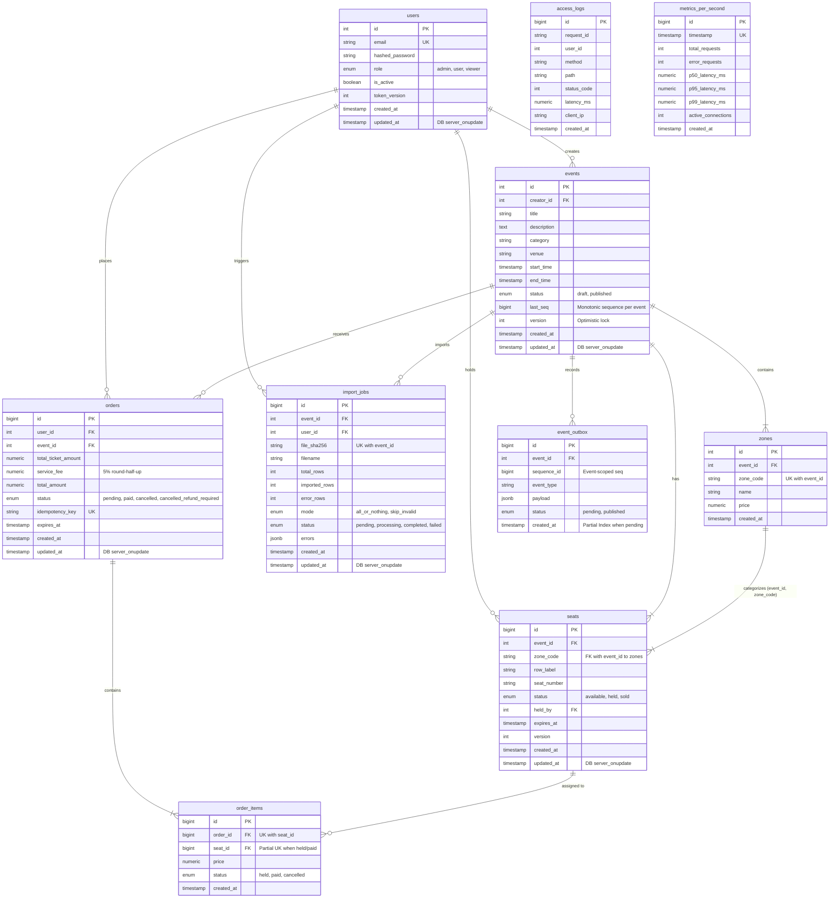

# 資料庫架構與 Schema 設計文件 (DATABASE.md)

本文件詳細記錄「高併發活動搶票與即時監控平台」之 PostgreSQL 16 資料庫設計，作為系統中訂單、座位狀態與交易事件的**唯一真實來源 (Single Source of Truth)**。

---

## 一、實體關聯圖 (Entity-Relationship Diagram)



---

## 二、資料表與欄位字典 (Data Dictionary)

### 1. `users` (使用者與權限)
| 欄位名稱 | 型別 | 屬性 | 說明 |
| :--- | :--- | :--- | :--- |
| `id` | `INTEGER` | PK | 使用者流水號識別碼 |
| `email` | `VARCHAR(255)` | UK, NOT NULL | 使用者帳號信箱 |
| `hashed_password` | `VARCHAR(255)` | NOT NULL | Bcrypt 加密雜湊密碼 |
| `role` | `ENUM` | NOT NULL | 角色權限：`admin`, `user`, `viewer` |
| `is_active` | `BOOLEAN` | NOT NULL, DEFAULT true | 是否啟用；停用時進行中的 Job 將被取消 (Q5.2) |
| `token_version` | `INTEGER` | NOT NULL, DEFAULT 1 | 憑證版本號，登出或改權限時遞增，實現 JWT 立即作廢 (Q5.1) |
| `created_at` | `TIMESTAMPTZ` | NOT NULL, DEFAULT CURRENT_TIMESTAMP | 建立時戳 (UTC) |
| `updated_at` | `TIMESTAMPTZ` | NOT NULL, ON UPDATE CURRENT_TIMESTAMP | **DB 伺服器時間自動更新**，避免應用端時鐘漂移 |

### 2. `events` (活動資訊與序號中樞)
| 欄位名稱 | 型別 | 屬性 | 說明 |
| :--- | :--- | :--- | :--- |
| `id` | `INTEGER` | PK | 活動唯一編號 |
| `creator_id` | `INTEGER` | FK (`users.id`), NOT NULL | 活動建立者（僅建立者與 Admin 可修改/刪除） |
| `title` | `VARCHAR(255)` | NOT NULL | 活動標題 |
| `description` | `TEXT` | NULL | 活動詳細描述 |
| `category` | `VARCHAR(100)` | NOT NULL | 分類 (音樂會/體育/展演等) |
| `venue` | `VARCHAR(255)` | NOT NULL | 場地名稱 |
| `start_time` | `TIMESTAMPTZ` | NOT NULL | 開賣/開始時間 |
| `end_time` | `TIMESTAMPTZ` | NOT NULL | 活動結束時間 |
| `status` | `ENUM` | NOT NULL, DEFAULT 'draft' | 狀態機：`draft`（草稿）, `published`（已發布） |
| `last_seq` | `BIGINT` | NOT NULL, DEFAULT 0 | **活動專屬事件單調遞增序號**，推播時防跳號之核心 (Q4.1) |
| `version` | `INTEGER` | NOT NULL, DEFAULT 1 | 樂觀鎖版本號，防止多人同時編輯相互覆蓋 |
| `created_at` | `TIMESTAMPTZ` | NOT NULL | 建立時戳 |
| `updated_at` | `TIMESTAMPTZ` | NOT NULL, ON UPDATE CURRENT_TIMESTAMP | DB 伺服器時間自動更新 |

### 3. `zones` (活動票價分區)
- **唯一限制**：`UNIQUE(event_id, zone_code)`（保證同一活動內分區代碼不重複）
- 包含 `price` 票價設定，作為訂票與 5% 服務費計算基準。

### 4. `seats` (座位庫存與鎖定狀態)
- **唯一限制**：`UNIQUE(event_id, zone_code, row_label, seat_number)`（防重複匯入相同位置）
- **複合外來鍵 (Composite FK)**：
  ```sql
  FOREIGN KEY (event_id, zone_code) 
  REFERENCES zones(event_id, zone_code) 
  ON DELETE CASCADE
  ```
  **效益**：兼顧 10 萬筆匯入時直接拿 CSV 原生 `zone_code` 寫入的極致效能，同時由資料庫強制驗證「該分區代碼必須合法存在於該活動的 zones 中」。
- **關鍵索引**：
  - `ix_seats_allocation`: `(event_id, zone_code, status, row_label, seat_number)`（配合 `FOR UPDATE SKIP LOCKED` 高速配位）
  - `ix_seats_held_expiry`: `(status, expires_at)`（背景 Cleanup Worker 撈取過期座位）
- **狀態欄位**：
  - `status`: `available` $\rightarrow$ `held` (鎖位中) $\rightarrow$ `sold` (已售出)
  - `held_by`: 鎖定該座位的 User ID
  - `expires_at`: 鎖位截止時戳（以 DB `NOW()` 為準，預設保留 10 分鐘）
  - `updated_at`: `server_onupdate=CURRENT_TIMESTAMP`

### 5. `orders` (購票訂單)
- **金額與手續費**：
  - `total_ticket_amount`: 票面總額
  - `service_fee`: 票價總和 5% 之服務費（**嚴格四捨五入至整數元**：`ROUND_HALF_UP`）
  - `total_amount`: 實付總額 (`total_ticket_amount + service_fee`)
- **狀態**：`pending` (待付款) $\rightarrow$ `paid` (已付款完成) $\rightarrow$ `cancelled` (逾時/自主取消) $\rightarrow$ `cancelled_refund_required` (逾時後 Webhook 到達且座位已被他人搶走，需自動退款)
- **冪等性**：`idempotency_key` 唯一約束，防止客戶端重複扣款。
- **查詢效能索引**：
  - `ix_orders_user_created`: `(user_id, created_at)` — 優化使用者「我的訂單」頁面之分頁排序查詢，避免 Seq Scan 全表掃描。
  - `ix_orders_pending_expiry`: `(expires_at) WHERE status = 'pending'` — 部分索引，優化過期訂單清理 Worker 掃描 `WHERE status = 'pending' AND expires_at < NOW()`，避免傳統合併 Bitmap Index Scan 開銷。

### 6. `order_items` (訂單座位明細 — 雙重約束物理防線)
- **約束 1：單一訂單防重複 (`uq_order_item_seat`)**：
  `UNIQUE(order_id, seat_id)` 保證同一張訂單內無法重複加入相同座位。
- **約束 2：跨訂單核心防超賣部分唯一索引 (`uq_active_seat_order`)**：
  ```sql
  CREATE UNIQUE INDEX uq_active_seat_order 
  ON order_items (seat_id) 
  WHERE status IN ('held', 'paid');
  ```
  **設計原理與權衡**：
  PostgreSQL 規定部分唯一索引的 `WHERE` 子句**不可跨表（Cannot JOIN）**。因此 `order_items` 必須冗餘維護 `status` 欄位。
  在搶票、逾時釋放與付款完成時，**`seats` 與 `order_items` 的狀態變更一律嚴格包在同一資料庫交易 (Transaction) 內**，由 ACID 事務保證一致性；同時藉由此部分索引，在資料庫實體層物理性杜絕任何同一座位被兩個有效訂單同時持有的可能！

### 7. `event_outbox` (Transactional Outbox 事件發布)
- **保證原子性**：座位狀態變更與 Outbox 寫入處於同一個 DB 事務。
- **欄位**：
  - `event_id`, `sequence_id`: 單一活動內的嚴格單調連續序號 (1, 2, 3...)。
  - `event_type`: 事件型態（如 `seat_held`, `seat_released`, `seat_sold`）。
  - `payload`: JSONB 資料（含座位座標、新狀態、時間戳、`request_id`）。
  - `status`: `pending` $\rightarrow$ `published`。
- **★ 核心效能優化：待發布部分索引 (Partial Index)**：
  ```sql
  CREATE INDEX ix_outbox_pending_relay 
  ON event_outbox (created_at) 
  WHERE status = 'pending';
  ```
  **設計原理**：
  隨售票進行，已發布歷史事件（`published`）將達數十萬筆。普通索引會導致 B-Tree 龐大膨脹；使用部分索引僅索引待發布事件（`pending`），索引體積微小，Relay Worker 的輪詢與發布能永遠保持在記憶體層級的 O(log N) 極速！

### 8. `import_jobs` (大數據座位背景匯入)
- **唯一限制**：`UNIQUE(event_id, file_sha256)`
- **業務規則**：
  - 當同一活動重複上傳內容完全相同的檔案時，DB 唯一約束阻止重複建立，API 自動回傳既有 Job。
  - 支援 `all_or_nothing` 與 `skip_invalid` 兩種模式。
  - `errors` (JSONB) 記錄所有異常列之原始行號與錯誤原因。

### 9. `access_logs` & `metrics_per_second` (日誌與監控)
- `access_logs`：記錄經過系統的每筆請求，包含 `request_id`、IP、路徑、狀態碼與毫秒級延遲。
- `metrics_per_second`：每秒聚合之 RPS、錯誤率、p50/p95/p99 延遲與在線連線數，由背景 Worker 批次寫入資料庫持久化。

---

## 三、狀態機生命週期 (State Machines)

### 1. 座位狀態流轉 (Seat Lifecycle)
```text
  [AVAILABLE] 
       │ 
       │ (1) 搶票指定選位 / 自動配位 (UPDATE status='held', expires_at=NOW()+10m)
       ▼
    [HELD] ───(2) 付款逾時釋放 / 使用者取消訂單 ───► [AVAILABLE]
       │
       │ (3) 金流 Webhook 成功回呼
       ▼
    [SOLD] (終態，已出票)
```

### 2. 訂單狀態與逾時收斂流轉 (Order Lifecycle)
```text
  [PENDING] (待付款，持有鎖位 10 分鐘)
       │
       ├─── (A) 10 分鐘內收到付款成功 Webhook ───► [PAID] (訂單成功出票)
       │
       ├─── (B) 使用者主動取消訂單 ──────────────► [CANCELLED] (座位釋放)
       │
       ├─── (C) 逾時未付款 (Cleanup Worker 釋放) ──► [CANCELLED] (座位釋放回 available)
       │
       └─── (D) 逾時後 Webhook 延遲到達 (Q2 邊界情況)
                 │
                 ├── 原座位仍為 available ──► [PAID] (訂單復活成功，重新佔位)
                 └── 原座位已被他人買走 ──► [CANCELLED_REFUND_REQUIRED] (觸發退款)
```

---

## 四、核心架構決策與優化矩陣 (Architectural Trade-offs)

### 1. `String(32)` + `CheckConstraint` 取代 PostgreSQL 原生 `ENUM`
- **問題背景**：PostgreSQL 原生 `CREATE TYPE ... AS ENUM` 在未來若需擴充狀態值（例如訂單新增 `partially_refunded`）時，無法在一般 Transaction 區塊中直接執行，且 Alembic autogenerate 難以自動追蹤值變更。
- **權衡決策**：在 ORM 層使用 Python `str, Enum` 保證應用層型別安全；在資料庫實體層使用 `VARCHAR(32)` 搭配 `CheckConstraint("status IN (...)")`。
- **優勢**：保留完全相同的儲存與檢索效能，同時使未來遷移無需鎖表，支援在單一 Transaction 內以原子操作完成狀態機遷移。

### 2. 全域伺服器時間戳一致性 (`CURRENT_TIMESTAMP`)
- **問題背景**：應用層 `onupdate=datetime.now` 會依賴 Python 應用伺服器的本地時間。在多複本叢集（如 `api-1`, `api-2`）或分散式環境中，各節點時間漂移可能產生幾十毫秒誤差，甚至出現 `updated_at < created_at` 的反常時序。
- **權衡決策**：所有時間戳（`created_at`, `updated_at`）統一交由 PostgreSQL 產生，宣告 `server_default=text("CURRENT_TIMESTAMP")` 與 `server_onupdate=text("CURRENT_TIMESTAMP")`。
- **優勢**：單一資料庫時間真實來源，確保分布式搶票、鎖位過期判斷（`expires_at < NOW()`）與審計日誌具備嚴格一致的時間基準。

### 3. 部分索引矩陣 (Partial Index Matrix)
本架構針對高頻背景任務與熱點資料設計了三組部分索引：
1. **`uq_active_seat_order` (`order_items.seat_id WHERE status IN ('held', 'paid')`)**：
   跨訂單的核心物理防線，保證同一座位絕不可能同時處於兩個有效的搶票/付款訂單中。
2. **`ix_outbox_pending_relay` (`event_outbox.created_at WHERE status = 'pending'`)**：
   隨搶票累積數十萬筆 `published` 歷史事件時，排除歷史資料，僅對待發布事件建索引，使 Relay Worker 輪詢速度永遠維持在微秒級。
3. **`ix_orders_pending_expiry` (`orders.expires_at WHERE status = 'pending'`)**：
   使過期清理 Worker 的定時掃描精確定位在過期且未付款的訂單上，避免掃描海量已完成（`paid`）或已取消（`cancelled`）的歷史訂單。

### 4. 複合外鍵與唯一性防線 (Composite Integrity)
- **`Seat` 複合外鍵**：`(event_id, zone_code)` 直接參照 `zones (event_id, zone_code)`，使得 10,000 筆座位批次匯入時無須逐筆將分區代碼查詢轉換為 `zone_id`，兼顧極致匯入效能與關聯完整性防線。
- **`Zone` 唯一約束**：`UNIQUE(event_id, zone_code)` 防止同一活動內重複建立同名分區。
- **`Seat` 唯一約束**：`UNIQUE(event_id, zone_code, row_label, seat_number)` 防止匯入時重複產生相同座位實體。
- **`ImportJob` 唯一約束**：`UNIQUE(event_id, file_sha256)` 防止管理員重複上傳相同檔案觸發重複匯入。
